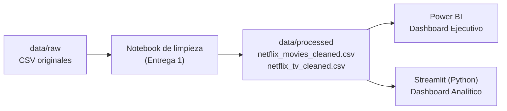

# StreamView Analytics — Visual Analytics

Solución de Visual Analytics (dashboards interactivos + narrativas visuales + productos gráficos) que apoya decisiones estratégicas sobre el catálogo audiovisual de StreamView Analytics. Proyecto de la asignatura **ADY1104 Visualización de Datos** (Duoc UC).

Este repositorio contiene dos entregas del caso semestral:

- **Entrega 1:** limpieza y preparación de datos, reglas de negocio, primeras visualizaciones e informe ejecutivo.
- **Entrega 2:** dos dashboards interactivos, uno por audiencia, construidos con herramientas distintas sobre los mismos datos limpios.

---

## Arquitectura



Los CSV de `data/processed/` son la **única fuente de datos**. Cada dashboard los lee por separado: Streamlit no lee el archivo `.pbix` ni al revés.

| Dashboard | Audiencia | Herramienta | Por qué esta herramienta |
|---|---|---|---|
| Ejecutivo | Directorio y Gerencia General | **Power BI** | Mapas, treemaps y tarjetas de KPI son visuales nativos, se arma rápido y se modifica visualmente sin código |
| Analítico | Gerencia de Contenidos y Adquisición | **Python (Streamlit, pandas, Plotly)** | Reutiliza directamente las columnas financieras ya calculadas en la Entrega 1 y separa con pandas las columnas con varios valores (género, país, actores, directores) |

Se evaluó D3 y se descartó: no aportaba ventajas para este encargo y es la opción más lenta de programar.

---

## Datos y reglas de negocio (resumen de la Entrega 1)

Fuentes: `netflix_movies_detailed_up_to_2025.csv` y `netflix_tv_shows_detailed_up_to_2025.csv` (~16.000 registros cada una), ya limpiadas.

- **Columnas eliminadas:** `duration` (vacía en películas y constante en series) y `rating` (copia exacta de `vote_average`, no era una clasificación por edad).
- **Duplicados:** 9 `show_id` repetidos en series, se conservó la primera ocurrencia.
- **Nulos de texto:** se rellenaron con "Sin dato" para no perder los datos numéricos de esos títulos.
- **Filtrado financiero:** presupuesto o ingresos en 0 (o menores a USD 1.000) se tratan como dato faltante, no como cero real. Solo **3.523 de 16.000 películas (22,0%)** tienen presupuesto e ingresos confiables.
- **Series:** no tienen columnas financieras en la fuente (Regla de Negocio 3: presupuesto e ingresos son exclusivos de películas).
- **Variables derivadas:** `ROI = ingresos / presupuesto` (solo con datos confiables) y `decada`.

---

## Dashboard Ejecutivo (Power BI)

Objetivo: comprender rápidamente el estado del catálogo y apoyar decisiones de inversión y crecimiento.

- **Modelo de datos:** tabla unificada `Catalogo_completo` (películas + series) y tablas dimensionales `catalog_countries` y `catalog_genres` (valores separados por coma convertidos en filas), relacionadas por `show_id`.
- **KPIs:** total de contenidos, películas, series, idiomas, países, géneros, popularidad promedio y calificación promedio.
- **Visualizaciones:** top 10 países, evolución de lanzamientos por año, treemap de géneros, películas vs series y mapa coroplético de producciones por país.
- **Filtros:** rango de años, género y tipo de contenido.
- **Medidas DAX:** `Total Películas` y `Total Series`.

## Dashboard Analítico (Streamlit)

Objetivo: orientar decisiones de adquisición y renovación de contenidos.

- **Filtros (barra lateral):** tipo de contenido, rango de años de estreno, rango de calificación, género, país e idioma.
- **Cinco pestañas:**
  1. **Popularidad y calificación:** dispersión (tamaño = votos, color = tipo, eje Y logarítmico) y correlación de Spearman.
  2. **Géneros:** barras de popularidad y calificación promedio por género, y treemap por volumen.
  3. **Rankings:** top 10 mejor evaluados (mínimo 50 votos), top 10 directores y top 10 actores.
  4. **Países:** mapa coroplético de calificación o popularidad (mínimo 5 títulos por país).
  5. **Finanzas:** KPIs (presupuesto promedio, total ingresos, total presupuesto, ROI aproximado), dispersión presupuesto vs ingresos, top 10 por ingresos y películas exitosas con presupuesto reducido. Incluye una nota visible con el conteo en vivo de películas incluidas.

Preguntas de negocio que responde:

| Pregunta | Dónde se responde |
|---|---|
| ¿Qué géneros priorizar? | Pestaña Géneros |
| ¿Qué países son oportunidad? | Pestaña Países |
| ¿Qué películas fueron exitosas con presupuestos reducidos? | Pestaña Finanzas, última sección |
| ¿Existe relación entre popularidad y calificación? | Pestaña Popularidad y calificación (correlación de Spearman) |

---

## Cómo ejecutar

**Dashboard Analítico (Streamlit)**, desde la raíz del repositorio:

```powershell
pip install -r dashboard\streamlit\requirements.txt
python -m streamlit run dashboard\streamlit\app.py
```

Si `streamlit` no se reconoce como comando, usar siempre `python -m streamlit`. Si el puerto 8501 está ocupado, Streamlit usa el 8502 (la terminal indica la URL).

**Dashboard Ejecutivo (Power BI):** abrir el archivo `.pbix` de `dashboard/powerbi/` con Power BI Desktop (solo Windows). Si Power BI no encuentra los CSV en otro computador: *Inicio → Transformar datos → Configuración de origen de datos → Cambiar origen*, y apuntar a `data/processed/`.

Para modificar títulos, umbrales, filtros o fechas en vivo, ver [`dashboard/GUIA_MODIFICACION_EN_VIVO.md`](dashboard/GUIA_MODIFICACION_EN_VIVO.md).

---

## Estructura del repositorio

```
Proyecto-StreamView-Analytics/
├── README.md
├── data/
│   ├── raw/                 # CSV originales, sin modificar
│   └── processed/           # CSV limpios (fuente única de los dashboards)
├── notebooks/               # limpieza y auditoría de datos (Entrega 1)
├── dashboard/
│   ├── powerbi/             # Dashboard Ejecutivo (.pbix)
│   ├── streamlit/           # Dashboard Analítico: app.py, requirements.txt, README_streamlit.md
│   └── GUIA_MODIFICACION_EN_VIVO.md
└── images/                  # capturas de los dashboards
```

---

## Flujo de trabajo (GitFlow)

El trabajo se hizo en relevo, con una rama por etapa que se integró a `main` antes de que empezara la siguiente:

| Etapa | Rama | Contenido |
|---|---|---|
| 1 | `feature/dashboard-ejecutivo` | Dashboard Ejecutivo en Power BI |
| 2 | `feature/dashboard-analitico` | Dashboard Analítico en Streamlit (sin bloque financiero) |
| 3 | `feature/dashboard-financiero` | Pestaña Finanzas, integración y documentación |

Cada rama se desarrolló con commits descriptivos y se fusionó a `main`.

---

## Decisiones y limitaciones conocidas

- **Clasificación etaria:** no existe en los datos reales (la columna que parecía serlo era un duplicado de `vote_average`). El filtro pedido para el Dashboard Analítico se omitió a propósito y así se informa dentro del dashboard.
- **Alcance financiero:** el análisis financiero cubre solo películas con presupuesto e ingresos informados (22,0% de las películas). Las series no tienen datos financieros.
- **ROI aproximado:** se calcula como total de ingresos dividido por total de presupuesto (la mediana por película se muestra como dato secundario, porque unos pocos casos extremos inflan el promedio). El ROI nunca es negativo; "no recuperó el presupuesto" significa ROI menor a 1.
- **Presupuesto reducido y éxito:** "presupuesto reducido" es el 25% más bajo del presupuesto entre todas las películas con datos; "éxito" exige ROI de al menos 3 e ingresos de al menos USD 10 millones, para no premiar casos con montos ínfimos. Ambos criterios son editables en la configuración de `app.py`.
- **Calificación 0 con 0 votos:** se interpreta como "sin votos", no como "mala". Se excluye de los promedios y de la dispersión del Dashboard Analítico (4.560 títulos).
- **Columnas con varios valores** (`country`, `genres`, `cast`, `director`): en Streamlit se separan fila por fila y "Sin dato" se excluye de los rankings.
- **Mapa de Streamlit:** usa un diccionario de códigos ISO-3 (cubre los países con 5 o más títulos). Un país que no esté en el diccionario no se dibuja.


---

## Equipo

- Etapa 1 — Dashboard Ejecutivo (Power BI)
- Etapa 2 — Dashboard Analítico (Streamlit)
- Etapa 3 — Bloque financiero, integración y documentación
