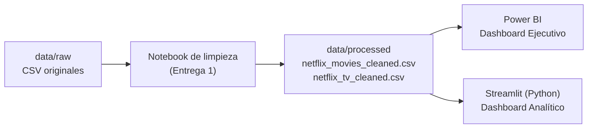

# StreamView Analytics — Visual Analytics

Solución de Visual Analytics (dashboards interactivos + narrativas visuales + productos gráficos) que apoya decisiones estratégicas sobre el catálogo audiovisual de StreamView Analytics. Proyecto de la asignatura **ADY1104 Visualización de Datos** (Duoc UC), Experiencia 3: evaluación crítica e implementación de mejoras.

---

## Arquitectura



Los CSV de `data/processed/` son la **única fuente de datos**. Cada dashboard los lee por separado: Streamlit no lee el archivo `.pbix` ni al revés.

| Dashboard | Audiencia | Herramienta | Por qué esta herramienta |
|---|---|---|---|
| Ejecutivo | Directorio y Gerencia General | **Power BI** | Mapas, treemaps y tarjetas de KPI son visuales nativos, se arma rápido y se modifica visualmente sin código |
| Analítico | Gerencia de Contenidos y Adquisición | **Python (Streamlit, pandas, Plotly)** | Reutiliza directamente las columnas financieras ya calculadas en la Entrega 1 y separa con pandas las columnas con varios valores (género, país, actores, directores) |

Se evaluó D3 y se descartó: no aportaba ventajas para este encargo y es la opción más lenta de programar.

---

## Datos y reglas de negocio (resumen de la Entrega 1)

Fuentes: `netflix_movies_detailed_up_to_2025.csv` y `netflix_tv_shows_detailed_up_to_2025.csv` (16.000 registros cada una), ya limpiadas. Tras la limpieza quedan **31.991 títulos** (16.000 películas y 15.991 series).

- **Columnas eliminadas:** `duration` (vacía en películas y constante en series) y `rating` (copia exacta de `vote_average`, no era una clasificación por edad).
- **Duplicados:** 9 `show_id` repetidos en series, se conservó la primera ocurrencia.
- **Nulos de texto:** se rellenaron con "Sin dato" para no perder los datos numéricos de esos títulos.
- **Filtrado financiero:** presupuesto o ingresos en 0 (o menores a USD 1.000) se tratan como dato faltante, no como cero real. Solo **3.523 de 16.000 películas (22,0%)** tienen presupuesto e ingresos confiables.
- **Series:** no tienen columnas financieras en la fuente (Regla de Negocio 3: presupuesto e ingresos son exclusivos de películas).
- **Variables derivadas:** `ROI = ingresos / presupuesto` (solo con datos confiables) y `decada`.

---

## Dashboard Ejecutivo (Power BI)

Objetivo: comprender rápidamente el estado del catálogo y apoyar decisiones de inversión y crecimiento.

- **Modelo de datos:** tabla unificada `Catalogo_completo` (películas + series) y tablas dimensionales `catalog_countries` y `catalog_genres` (valores separados por coma convertidos en filas), relacionadas por `show_id`.
- **KPIs:** total de contenidos (31.991), películas, series, idiomas, países, géneros, popularidad promedio (42,63, con la nota "Índice relativo TMDB") y calificación promedio (6,63, calculada solo sobre los 27.431 títulos con votos).
- **Visualizaciones:** top 10 países, distribución por año de estreno, treemap de géneros, películas vs series y mapa coroplético de producciones por país.
- **Filtros:** rango de años, género y tipo de contenido.
- **Medidas DAX:** `Total Películas` y `Total Series`.

## Dashboard Analítico (Streamlit)

Objetivo: orientar decisiones de adquisición y renovación de contenidos.

- **Filtros (barra lateral):** tipo de contenido, rango de años de estreno, rango de calificación, género, país e idioma.
- **Cinco pestañas:**
  1. **Popularidad y calificación:** dispersión (tamaño = votos, color = tipo, eje Y logarítmico) y correlación de Spearman, con aviso si la selección no tiene varianza.
  2. **Géneros:** barras de popularidad y calificación promedio por género, y treemap por volumen, con nota de pertenencia múltiple.
  3. **Rankings:** top 10 mejor evaluados (mínimo 50 votos), top 10 directores y top 10 actores, separando el total de títulos de los títulos evaluados.
  4. **Países:** mapa coroplético de calificación o popularidad (mínimo 5 títulos con votos por país), con el conteo de países representados y excluidos.
  5. **Finanzas:** KPIs (presupuesto promedio, total ingresos, total presupuesto, ROI agregado, mediano y promedio, con la cobertura del 22,0 %), dispersión presupuesto vs ingresos, top 10 por ingresos y películas exitosas con presupuesto reducido. Incluye una nota visible con el conteo en vivo de películas incluidas.

Preguntas de negocio que responde:

| Pregunta | Dónde se responde |
|---|---|
| ¿Qué géneros priorizar? | Pestaña Géneros |
| ¿Qué países son oportunidad? | Pestaña Países |
| ¿Qué películas fueron exitosas con presupuestos reducidos? | Pestaña Finanzas, última sección |
| ¿Existe relación entre popularidad y calificación? | Pestaña Popularidad y calificación (correlación de Spearman) |

---

## Evaluación crítica y mejoras (Experiencia 3)

Se aplicó el marco de cinco pasos del material 3.3.1 (comprender el objetivo, revisar los datos, evaluar la representación, analizar la interpretación y proponer mejoras) y se revisaron los errores y sesgos frecuentes. Las mejoras se implementaron y validaron en ambas herramientas.

**Streamlit**

- Nota visible que diferencia el índice de popularidad TMDB del consumo real.
- Rankings de directores y actores con total de títulos separado de los evaluados; el promedio se calcula solo con títulos con votos.
- Correlación de Spearman (0,32, n = 27.431) con aviso automático cuando no hay varianza.
- Finanzas con ROI agregado (2,92x), mediano (1,70x) y promedio (4,29x), cobertura visible y aviso ante filtros vacíos o solo series.
- Mapa con 86 países representados y 60 excluidos por el umbral mínimo.

**Power BI**

| ID | Elemento | Cambio |
|---|---|---|
| BI01 | Paleta | Rojo películas (`#E50914`), azul series (`#1F77B4`) y verde neutro para totales por país |
| BI02 | Popularidad | Nota "Índice relativo TMDB" en la tarjeta |
| BI03 | Calificación | Filtro `vote_count > 0` y nota "Títulos con votos (27.431)": el promedio pasó de 5,69 a 6,63 |
| BI04 | Visualización temporal | Renombrado a "Distribución por Año de Estreno" con aviso de muestra estratificada |
| BI05 | Países y géneros | Subtítulos de pertenencia múltiple |
| BI06 | Mapa | Subtítulo que indica la exclusión de registros 'Sin dato' |
| BI07 | Filtros y títulos | Verificados sin cambios |
| BI08 | Fuentes | Orígenes reconfigurados a `data\processed\` |

---

## Cómo ejecutar

**Dashboard Analítico (Streamlit)**, desde la raíz del repositorio (los comandos funcionan igual en Windows, macOS y Linux):

```bash
pip install -r requirements.txt
python -m streamlit run dashboard/streamlit/app.py
```

Si `streamlit` no se reconoce como comando, usar siempre `python -m streamlit`. Si el puerto 8501 está ocupado, Streamlit usa el 8502 (la terminal indica la URL).

**Notebooks** (limpieza, visualización y storytelling), en este orden y abriéndolos desde la carpeta `notebooks/`:

```bash
cd notebooks
jupyter notebook          # abrir y ejecutar 01_limpieza_datos, 02_Visualizacion, 03_storytelling
```

El notebook 01 genera los CSV de `data/processed/`; los notebooks 02 y 03 y el dashboard solo los leen.

**Dashboard Ejecutivo (Power BI):** abrir el archivo `DashBoard_Ejecutivo.pbix` de `dashboard/PowerBi/` con Power BI Desktop (solo Windows). Si Power BI no encuentra los CSV en otro computador: *Inicio → Transformar datos → Configuración de origen de datos → Cambiar origen*, y apuntar a `data/processed/`.

---

## Estructura del repositorio

```
Proyecto-StreamView-Analytics/
├── README.md
├── requirements.txt         # dependencias de todo el proyecto
├── data/
│   ├── raw/                 # CSV originales, sin modificar
│   └── processed/           # CSV limpios (fuente única de los dashboards)
├── notebooks/               # 01 limpieza · 02 visualización · 03 storytelling
├── src/
│   └── utils.py             # código compartido: carga de datos, paleta de colores, ISO-3, formatos
├── dashboard/
│   ├── PowerBi/             # Dashboard Ejecutivo (DashBoard_Ejecutivo.pbix)
│   └── streamlit/           # Dashboard Analítico: app.py, requirements.txt
├── docs/
│   ├── informe/             # secciones del informe ejecutivo en Markdown (01 a 10)
│   ├── mejoras_powerbi.md   # registro de revisión y cambios en Power BI
│   └── Informe_Ejecutivo_StreamView_Analytics.pdf
└── images/                  # capturas de evidencia de Streamlit y Power BI
```

---

## Flujo de trabajo (GitFlow)

**Entregas anteriores.** El trabajo se hizo en relevo, con una rama por etapa que se integró a `main` antes de que empezara la siguiente:

| Etapa | Rama | Contenido |
|---|---|---|
| 1 | `feature/dashboard-ejecutivo` | Dashboard Ejecutivo en Power BI |
| 2 | `feature/dashboard-analitico` | Dashboard Analítico en Streamlit (sin bloque financiero) |
| 3 | `feature/dashboard-financiero` | Pestaña Finanzas, integración y documentación |

**Experiencia 3.** Trabajo secuencial: cada persona terminó su parte e integró su rama a `main` antes del traspaso.

| Etapa | Rama | Contenido |
|---|---|---|
| 1 | `feature/persona-1` | Corrección de notebooks, `src/`, requirements, README e informe (secciones 1 a 5) |
| 2 | `feature/persona-2` | Informe (secciones 6 a 9), evaluación crítica y mejoras en Streamlit |
| 3 | `feat/juan-cierre-proyecto` | Mejoras en Power BI, capturas, conclusiones, informe final y presentación |

Cada rama se desarrolló con commits descriptivos y se fusionó a `main`.

---

## Paleta de colores (única para todo el proyecto)

| Elemento | Color | HEX |
|---|---|---|
| Películas | Rojo | `#E50914` |
| Series | Azul | `#1F77B4` |
| Totales | Verde neutro | — |

Definida en `src/utils.py` y usada en los notebooks y en Streamlit. **En Power BI se utilizan estos mismos criterios cromáticos.**

## Decisiones y limitaciones conocidas

- **Clasificación etaria:** no existe en los datos reales (la columna que parecía serlo era un duplicado de `vote_average`). El filtro pedido para el Dashboard Analítico se omitió a propósito y así se informa dentro del dashboard.
- **Popularidad:** es un índice relativo de TMDB. Mide visibilidad externa, no reproducciones ni retención dentro de StreamView, y no debe leerse como demanda de suscriptores.
- **Alcance financiero:** el análisis financiero cubre solo películas con presupuesto e ingresos informados (22,0% de las películas). Las series no tienen datos financieros.
- **ROI:** el ROI agregado (total de ingresos dividido por total de presupuesto, 2,92x) se muestra junto a la mediana por película (1,70x) y el promedio (4,29x), porque unos pocos casos extremos (máximo 559x) inflan el promedio. Es una razón ingresos/presupuesto en taquilla, no beneficio neto ni rentabilidad de licencias. El ROI nunca es negativo; "no recuperó el presupuesto" significa ROI menor a 1 (36,6% de las películas con datos).
- **Presupuesto reducido y éxito:** "presupuesto reducido" es el 25% más bajo del presupuesto entre todas las películas con datos; "éxito" exige ROI de al menos 3 e ingresos de al menos USD 10 millones, para no premiar casos con montos ínfimos. Ambos criterios son editables en la configuración de `app.py`.
- **Calificación 0 con 0 votos:** se interpreta como "sin votos", no como "mala". Se excluye de los promedios (Streamlit y Power BI) y de la dispersión del Dashboard Analítico (4.560 títulos: 5,6% de las películas y 22,9% de las series).
- **Columnas con varios valores** (`country`, `genres`, `cast`, `director`): un título puede pertenecer a varias categorías. En Streamlit se separan fila por fila y "Sin dato" se excluye de los rankings.
- **Muestra estratificada:** el conjunto de datos tiene exactamente 1.000 películas y 1.000 series por año de estreno (2010-2025; 991 series en 2025 tras eliminar duplicados). Los conteos por año no reflejan el tamaño real del catálogo y el gráfico de evolución temporal es plano por construcción.
- **Mapa de Streamlit:** usa un diccionario de códigos ISO-3 (cubre los países con 5 o más títulos). Un país que no esté en el diccionario no se dibuja.

---

## Equipo

| Persona | Nombre | Rol |
|---|---|---|
| 1 | Benjamín Barrera | Cimientos: repositorio, datos y contexto del problema |
| 2 | Patrick González | Diseño, evaluación crítica y mejoras en Streamlit |
| 3 | Juan Villegas | Cierre: Power BI, informe final y presentación |